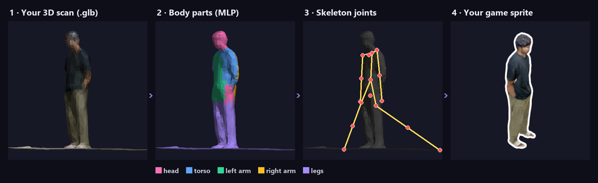
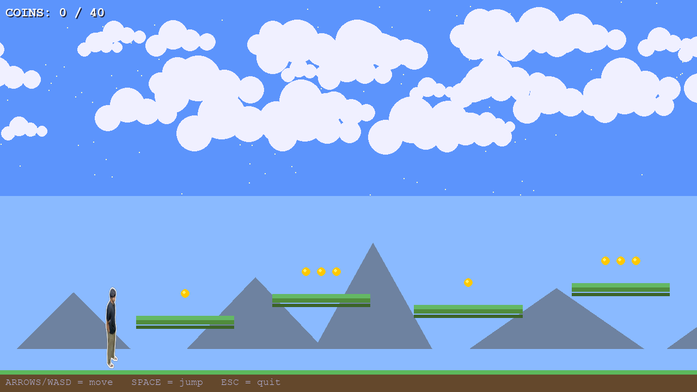

<div align="center">

# 🕹️ RetroAvatarQuest

### Scan yourself in 3D. Play as yourself in 2D. Control it by waving your hand.

**A pipeline that turns any 3D humanoid model into a retro platformer hero — segmenting the body with a small
neural network trained on real human scans — and a game you can steer with a proximity sensor on an Arduino.
All of it on a regular CPU.**




<sub>Real output: my own phone 3D scan → body parts → skeleton → the hero of the game.</sub>



</div>

---

## How it works

```
your 3D model (.glb)                CAPE scans (real people)
        │                                   │
        ▼                                   ▼
 glb_parser ──► mesh_segment ◄──── train a tiny MLP (CPU, minutes)
                  head · torso · arms · legs
                        │
            skeleton_extract ──► joints.json
            render_profile   ──► avatar.png  (side-on pixel sprite)
                        │
                        ▼
          game/ (pygame platformer) ◄── keyboard  or  Arduino proximity sensor
```

1. **Parse** any humanoid `.glb` (a phone 3D scan, Ready Player Me, Mixamo…).
2. **Segment** the mesh into head, torso, left arm, right arm and legs: geometric height/side heuristics first,
   refined by a lightweight MLP trained on the [CAPE](https://cape.is.tue.mpg.de/) dataset of real human scans.
3. **Extract** joint positions and **render** a side-profile sprite.
4. **Play**: a 6,000-px scrolling level with platforms, physics, 30+ coins and a goal flag; your avatar is the hero.

No CAPE data? The pipeline falls back to the geometric heuristics. No avatar generated? The game uses a built-in hero.

**Try it with the files in this repo:** `assets/input_model.glb` is the scan above and `outputs/` holds what the pipeline
made from it (`avatar.png`, `joints.json`, `segmentation.npz`, `clean_mesh.glb`), so `cd game && python main.py` starts
you straight away as the scanned hero.

## Control it with your hand

Plug an Arduino with a proximity sensor into USB and the game reads `PROX:<value>` lines over serial:

| Your hand is… | The hero… |
|---|---|
| very close | jumps |
| at medium distance | runs left |
| far away | runs right |

No board connected? The game notices and runs on the keyboard alone.

| Key | Action |
|---|---|
| ← / A, → / D | Move |
| Space | Jump |
| R | Restart after a win or a fall |
| Esc | Quit |

## Run it

```bash
pip install -r requirements.txt

# Play right away (as the scanned hero in outputs/)
cd game
python main.py

# Make YOURSELF the hero
#   1. scan yourself with any phone 3D-scan app, export .glb, save it as assets/input_model.glb
#   2. (optional) extract CAPE sample 00096 into aibody/cape_data/00096/  (~6–8 GB, not included)
cd aibody
python train_body_model.py        # → outputs/avatar.png, outputs/joints.json
```

Arduino on another port? Change `PORT = "COM3"` in `game/arduino_bridge.py`.

## Project structure

```
aibody/
  glb_parser.py        load the .glb mesh
  train_body_model.py  the whole pipeline in one command
  mesh_segment.py      body-part segmentation (heuristics + MLP)
  skeleton_extract.py  joint positions → outputs/joints.json
  render_profile.py    side-profile sprite → outputs/avatar.png
game/
  main.py              game loop, camera, HUD, win / game-over screens
  level.py             platforms, coins, clouds, goal flag
  player.py            hero sprite and movement
  physics.py           gravity, jumping, collisions
  arduino_bridge.py    optional sensor input over serial
assets/input_model.glb the sample 3D scan (replace it with yours)
outputs/               what the pipeline made from it: avatar.png, joints.json, segmentation.npz, clean_mesh.glb
```

## Limits and next steps

Simple physics and animation today. Next up: animate the sprite from `joints.json`, more sensor gestures,
and more levels.
